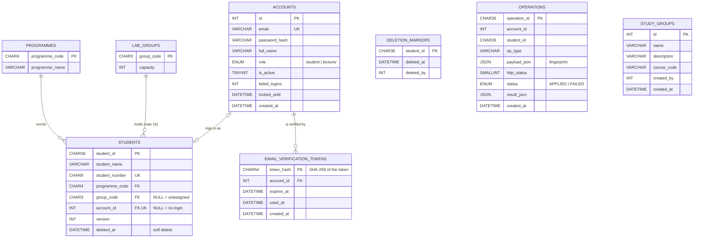

# Database diagram

The schema lives in `database/schema.sql`. This diagram shows the tables and their foreign keys.
Dashed relationships are logical links with no database constraint (see the notes below).

## Notes

- **`deletion_markers`** has no foreign key to `students`. A marker must outlive its student row
  for sync, so the link is logical only.
- **`operations`** has no foreign keys. The receipt must survive even if the account or student
  is later removed, and its `account_id` may refer to a test account.
- **`study_groups`** is separate from `lab_groups`. It holds campus life groups, not the lab
  groups G01–G14.
- **Student numbers** stay reserved after a delete, because `student_number` is never cleared.
- **Group capacity** (16) is not stored as a constraint. It is enforced in
  `assignToGroupTx` under `SELECT … FOR UPDATE` on the `lab_groups` row.
